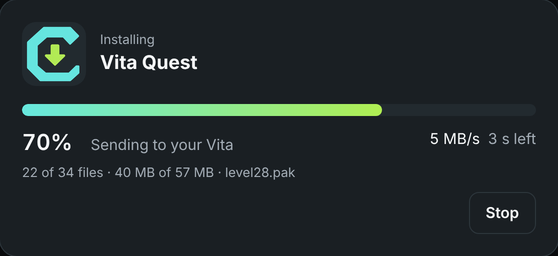

<p align="center"></p>

<h1 align="center">CBOC Vita Installer</h1>

<p align="center"><b>Put games on your PS Vita from your computer.</b><br>
No FTP client, no VitaShell menus, no copying folders around.</p>

<p align="center">
<a href="https://github.com/CBOC-Vita-Lab/vita-installer/releases/latest"><b>Download</b></a> ·
<a href="#how-to-use-it">How to use it</a> ·
<a href="#questions">Questions</a> ·
<a href="docs/release-format.md">For port authors</a>
</p>

---

<p align="center"></p>

Drop in a game (a `.vpk`, a release `.zip`, a folder, or a GitHub link), and the installer finds your Vita, sends everything over and installs it. If the game needs something you have to supply yourself, like your own disc, it asks for that one file, checks it's the right one and does the rest.

- **Works with any Vita app or game.** Any VPK works. Release ZIPs that ship `data/` or `ux0/` folders get those copied too. CBOC releases also get their extra steps done automatically.
- **Finds your Vita for you.** It looks for it on your Wi-Fi, and spots a Vita memory card or VitaShell USB connection plugged into the computer.
- **Fast.** It sends several files at once and skips anything your Vita already has, so updates and retries only send what changed. Wi-Fi installs need no button presses on the Vita.
- **Converts your game files for the port.** When a port needs your disc's data in a different form (Super Mario Galaxy, for example), it converts it on your computer, checks every file and shrinks the movies, then copies the result. No scripts to run.
- **Safe for your saves.** It never deletes your files on the Vita, and it never touches the save and settings folders a release marks as protected.
- **Small and runs on old computers.** About 6 MB, nothing else to install. Works on macOS 10.13 and later, Windows 7 and later, and Linux.

## Download

| Computer | File |
| --- | --- |
| Mac (Intel or Apple Silicon, macOS 10.13+) | `CBOC-Vita-Installer-…-mac.zip` |
| Windows 10 / 11 (most PCs) | `CBOC-Vita-Installer-…-windows-x64.exe` |
| Windows 7 / 8 or 32-bit Windows | `CBOC-Vita-Installer-…-windows-x86.exe` |
| Windows on ARM | `CBOC-Vita-Installer-…-windows-arm64.exe` |
| Linux | `CBOC-Vita-Installer-…-linux-amd64.tar.gz` (or `arm64`) |

All files are on the [latest release](https://github.com/CBOC-Vita-Lab/vita-installer/releases/latest).

**First launch on a Mac:** unzip, then right-click the app and choose **Open**. On newer macOS, if it is still blocked, go to **System Settings > Privacy & Security** and click **Open Anyway**. It also asks to find devices on your local network; allow this so it can find your Vita. [More help](docs/mac-open.md)

**First launch on Windows:** if SmartScreen says "Windows protected your PC", click **More info > Run anyway**. The app is not code-signed, which is why Windows asks.

## How to use it

1. **Open the installer.** It opens in your web browser. The page only runs on your own computer.
2. **Turn on your Vita's connection.** In VitaShell, press **SELECT** to start FTP. The installer finds the Vita by itself. If you have [Vita Companion](https://github.com/devnoname120/vitacompanion) you can skip this, and the installer can start the game for you when it's done.
3. **Add a game.** Drag it onto the window, click **Choose file**, or paste a GitHub link. CBOC games are listed on the start screen, and one click downloads them.
4. **Add anything it asks for.** For example your own game disc (ISO, RVZ, WBFS, or a folder extracted with Dolphin) or the shader compiler. Files sitting next to the download are found automatically.
5. **Click Install.** That's it. Add several games and they install one after another.

<p align="center"></p>

### Big games: use USB

Wi-Fi on the Vita is slow, around 2–4 MB/s. For games of a gigabyte or more, USB is several times faster. In VitaShell press **START**, set **SELECT button** to **USB**, plug in the cable and press **SELECT**. The installer finds the drive by itself. A memory card in a card reader works the same way. USB and card installs copy everything; you then press **X** on the game in VitaShell's `ux0:VPK` folder to install it.

## Questions

**Which games work?** Any Vita app or homebrew in `.vpk` form, plus release ZIPs that contain one. If a release needs your own game files and doesn't say how, copy them the way its readme says. Releases can describe their extra steps in a [`vita-install.json`](docs/release-format.md) file so the installer handles them.

**What does it need on the Vita?** A Vita running HENkaku/Ensō with VitaShell. Over Wi-Fi it uses VitaShell's FTP server and its built-in remote install. With Vita Companion it can also install and launch games while VitaShell is closed.

**It can't find my Vita.** Make sure the Vita shows the FTP screen (VitaShell, **SELECT**) and that both are on the same Wi-Fi. Then click the status button at the top right and type the address the Vita shows (for example `192.168.1.20`). Guest networks and some mesh networks keep devices apart; USB always works.

**Is my disc or game uploaded anywhere?** No. Everything happens between your computer and your Vita. The only internet traffic is checking for installer updates, downloading a game when you paste a link, and downloading the disc unpacker ([nodtool](https://github.com/encounter/nod), checked against a fixed hash) the first time you give it an ISO or RVZ.

**My Mac is older than macOS 12, or my PC runs Windows 7/8, and it asks for an extracted folder.** The disc unpacker needs macOS 12 / Windows 10. On older systems, extract the disc in Dolphin first: right-click the game > **Properties** > **Filesystem**, right-click the disc > **Extract Entire Disc**, then choose that folder.

**I already extracted my game, or it's already on the Vita.** Choose (or drag in) the extracted folder; the installer finds the `sys/` and `files/` folders inside it (even in a `DATA` subfolder), checks it's the right game and copies them to the exact place the port expects. If the game files are already on your Vita, it notices, marks them "Already on your Vita" and doesn't ask for them at all, so updating only sends the app.

**It says it's converting my game. How long does that take?** A few minutes for a big game such as Super Mario Galaxy, once. It needs some free space on your computer (about the size of the game) and never changes your own files. If you install again, it reuses the converted copy, and if the converted game is already on your Vita, it isn't sent again.

**How do updates work?** Connect your Vita and the start screen shows the games the installer put on it, with an **Update** button when there is a newer release. Updating only sends the files that changed (checked by content, not just size) and never touches your saves, settings, game data or HD texture packs.

**Can it add Infected's HD textures?** Yes. Infected has two optional slots for HD texture packs you made from your own disc with the texture builder (the packs can't be shared, because they come from the game). Choose `texpack_2x.bin` and/or `texpack_4x_mixed.bin`; the installer puts them where the game looks for them, and refuses the full 4x pack, which is too big for the Vita.

**The transfer stopped halfway.** Keep the Vita awake and press **Install** again. Files that finished are not sent again.

## For developers

```sh
go test ./...                    # tests, including a fake Vita FTP server
go run .                         # run from source
go run ./internal/fakevita/cmd/fakevita -root /tmp/fake-vita -speed 3   # a pretend Vita to try it with
scripts/build.sh 1.0.0           # every download, into dist/
```

The app is a single Go program (Go 1.20 so it still targets Windows 7 and macOS 10.13) with no dependencies outside the standard library. Its page is plain HTML, CSS and JavaScript in `ui/`.

| Folder | What it does |
| --- | --- |
| `internal/vita` | Reads VPKs and `param.sfo` |
| `internal/release` | Turns a VPK, ZIP or folder into installable releases; `vita-install.json` |
| `internal/prep` | Checks and unpacks game discs (Wii/GameCube, PSP) |
| `internal/galaxy`, `internal/catalog` | Converts game data for ports (Super Mario Galaxy, Yaz0, THP movies) and checks files against expected hashes |
| `internal/ftp`, `internal/device` | Talks to the Vita; finds it on the network or as a drive |
| `internal/install` | Plans, sends and installs, with resume and parallel transfers |
| `internal/web`, `ui/` | The local page and its state |

To release, put the new version at the top of `CHANGELOG.md` (`## 1.0.1`) and push to `main`: GitHub builds every download on a Mac and publishes the release with that section as its notes (`.github/workflows/release.yml`).

Written entirely by AI (Claude), fully vibecoded. MIT licensed.
