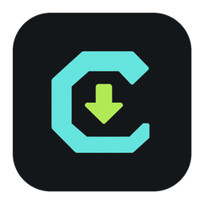
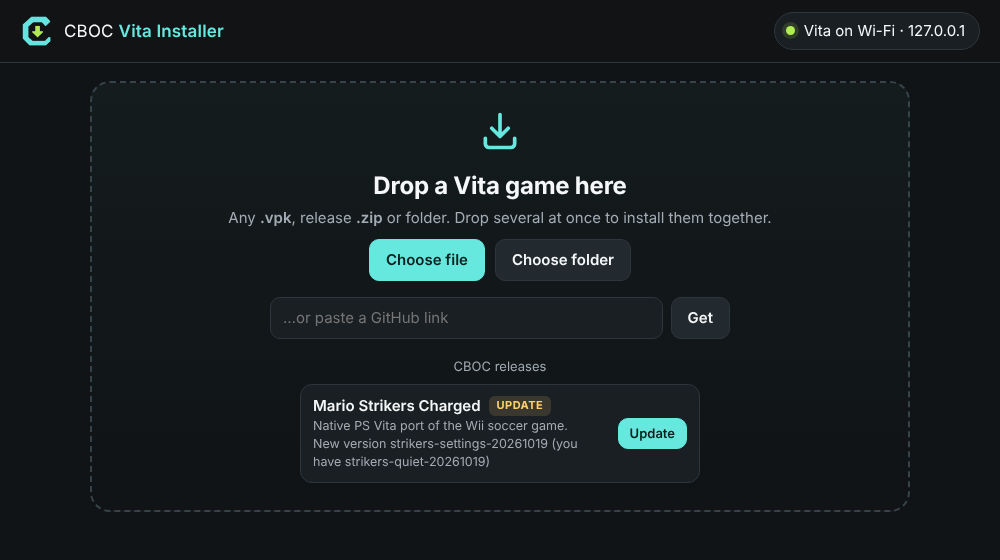
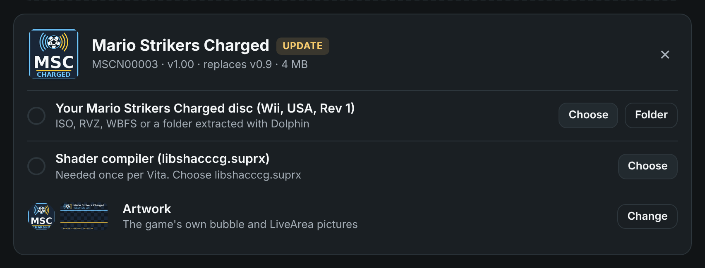
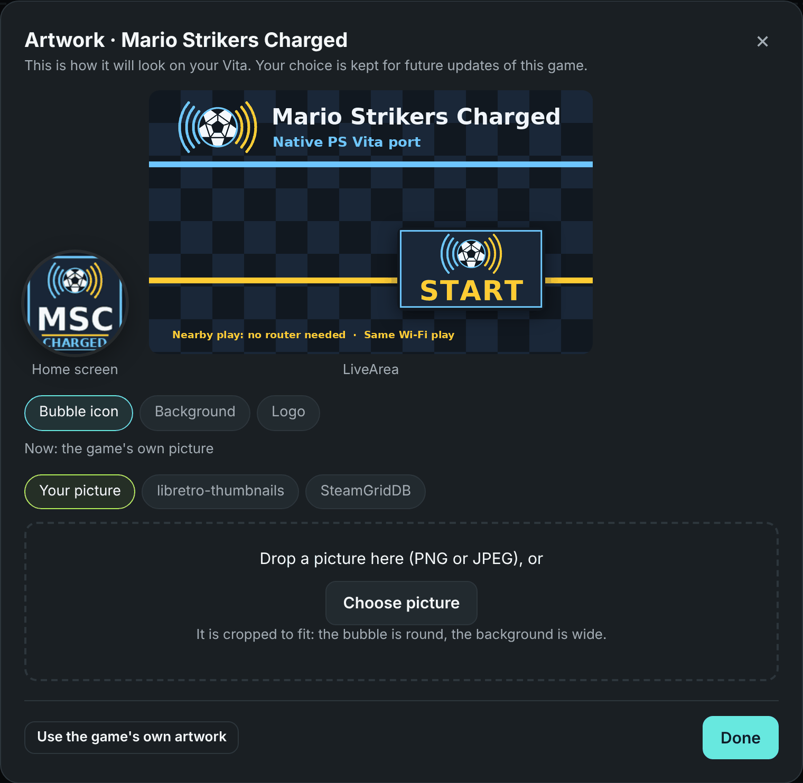

<h1 align="center">CBOC Vita Installer</h1>

<b>Your games, on your Vita, in a few clicks.</b>

Putting a game on a PS Vita used to mean FTP apps, folder hunting and a lot of guesswork. CBOC Vita Installer does it for you. Pick a game, press **Install**, and it finds your Vita, sends everything to the right place and installs it. When it's done, the game is waiting on your home screen.

<b><a href="https://github.com/CBOC-Vita-Lab/vita-installer/releases/latest">Download the latest version</a></b> · <a href="#how-to-use-it">How to use it</a> · <a href="CHANGELOG.md">What's new</a> · <a href="#help">Help</a>

## New In Version 1.4

**Make every game look the way you want.** Each game now has an **Artwork** button. Pick a new home-screen bubble, LiveArea background and logo, and see exactly how it will look on your Vita before you install.

- **Your own pictures.** Drop in any PNG or JPEG. It's cropped and converted for the Vita automatically.
- **libretro-thumbnails.** Box art, title screens and screenshots for thousands of games. No account needed.
- **SteamGridDB.** Icons, wide backgrounds and logos made by its community. Just paste your own free API key once.
- **Kept for updates.** Your artwork is remembered and goes back on every time you update the game.

## Recent Highlights

- **Any file name works** (1.3): downloads are recognised by what's inside them, and every GitHub download is checked before it reaches your Vita.
- **Keeps itself up to date** (1.2): new versions download in the background and switch over with one click.
- **Runs almost everywhere** (1.1): Intel and Apple Silicon Macs back to macOS 10.13, Windows 7 to 11 (including 32-bit and ARM) and Linux, in a 7 MB download.
- **Faster, hands-free installs:** several files at once, nothing to press on the Vita, and it picks up after a Wi-Fi drop.
- **Bring your own game:** Wii, GameCube and PSP games, checked and converted for the Vita when needed (Super Mario Galaxy included). Homebrew like VitAdhoc gets slots for your own games and BIOS, and Infected for your HD texture packs.
- **Smart updates:** shows **Update** when a game has a new version and sends only what changed. Your saves are never touched.

## What To Expect

| | |
| --- | --- |
| **Computers** | Mac (Intel or Apple Silicon, macOS 10.13 and newer), Windows 7, 8, 10 and 11 (64-bit, 32-bit and ARM), Linux (PC and ARM) |
| **Your Vita** | Any homebrew-enabled Vita (HENkaku or Ensō) with VitaShell |
| **Wi-Fi speed** | The Vita's Wi-Fi manages about 2–4 MB/s, so a 2 GB game takes 10–20 minutes. USB is several times faster |
| **Game updates** | Usually seconds, because only changed files are sent |
| **Installer updates** | Automatic: downloaded in the background, switched over with one click or the next time you open it |
| **Super Mario Galaxy** | About 2–3 minutes to convert your disc on a recent computer, once |
| **Artwork** | Optional. Your own pictures, libretro-thumbnails, or SteamGridDB with your free API key |
| **Your files** | Nothing is uploaded anywhere. Everything stays between your computer and your Vita |

## How To Use It

**You'll need:** your Vita with VitaShell, the same Wi-Fi as your computer (or a USB cable), and your own copy of any game that asks for one.

1. **Download** the file for your computer from the [latest release](https://github.com/CBOC-Vita-Lab/vita-installer/releases/latest) and open it. It opens in your web browser.
2. **On your Vita, open VitaShell and press SELECT.** The installer finds it by itself.
3. **Pick a game.** Click **Get** next to a CBOC game, drop in a `.vpk` or `.zip`, or paste a GitHub link.
4. **Add what it asks for,** like your own game disc. Choose a file or a folder, or just drag it onto the line.
5. **Press Install.** That's it.

**First launch:** on a Mac, right-click the app and choose **Open** ([more help](docs/mac-open.md)). On Windows, if a blue "Windows protected your PC" box appears, click **More info > Run anyway**.

### Change a Game's Artwork

1. Press **Artwork** on the game, before you install.
2. Pick what to change: **Bubble icon**, **Background** or **Logo**.
3. Pick a source:
   - **Your picture:** drop in a PNG or JPEG.
   - **libretro-thumbnails:** search box art, title screens and screenshots. No account needed.
   - **SteamGridDB:** paste your free API key once, then search icons, backgrounds and logos.
4. Watch the preview change, then press **Done** and **Install**.

Your choice is remembered and goes back on every time the game is updated. **Use the game's own artwork** undoes it.

### Updating

- **Games:** connect your Vita and open the installer. Games with a new version show **Update**. Only what changed is sent, and your saves stay put.
- **The installer:** it gets new versions by itself. Click **Update now** on the banner, or just open it next time.

## Help

**The update banner says to download it myself.** On a Mac, move the app into your **Applications** folder first; macOS doesn't let apps update themselves while they run straight from Downloads.

**It can't find my Vita.** Keep VitaShell's FTP screen open and both devices on the same Wi-Fi. You can also click the status button at the top right and type the address your Vita shows.

**I want it faster.** Use USB: in VitaShell press **START**, set **SELECT button** to **USB**, plug in the cable and press **SELECT**. When it's done, press **X** on the game in VitaShell's `ux0:VPK` folder.

**The transfer stopped.** Press **Install** again. It picks up where it left off.

**My Mac or PC is older and it asks for an extracted folder.** Unpacking disc images needs macOS 12 or Windows 10. On older systems, extract the disc in Dolphin first (right-click the game > **Properties** > **Filesystem** > **Extract Entire Disc**) and choose that folder.

## Download Contents

| File | What it is |
| --- | --- |
| `CBOC-Vita-Installer-1.4-mac.zip` | The Mac app, for Intel and Apple Silicon |
| `CBOC-Vita-Installer-1.4-windows-x64.exe` / `-x86.exe` / `-arm64.exe` | Windows: most PCs, older or 32-bit PCs, and ARM PCs |
| `CBOC-Vita-Installer-1.4-linux-amd64.tar.gz` / `-arm64.tar.gz` | Linux |
| `SHA256SUMS.txt` | Checksums, if you want to check your download |

## For Developers

| | |
| --- | --- |
| [Ideas for later](docs/ROADMAP.md) | Features we'd like to add, such as custom loading screens |
| [Release format](docs/release-format.md) | How a Vita release tells the installer what it needs, including converting the player's files |
| Build and test | `go test ./...`, then `scripts/build.sh 1.4` (Go 1.20, no other dependencies) |

The app is one Go program with a plain HTML page in `ui/`. The code is in `internal/`.

## Credits

Built by AI agents (Claude) and directed by a human. Disc images are unpacked with [nodtool](https://github.com/encounter/nod). Artwork search uses [libretro-thumbnails](https://github.com/libretro-thumbnails/libretro-thumbnails) and [SteamGridDB](https://www.steamgriddb.com); their pictures belong to their creators and are downloaded straight to your computer, never stored here. Free and open source under the MIT license.

An unofficial fan project, not affiliated with Nintendo or Sony.
